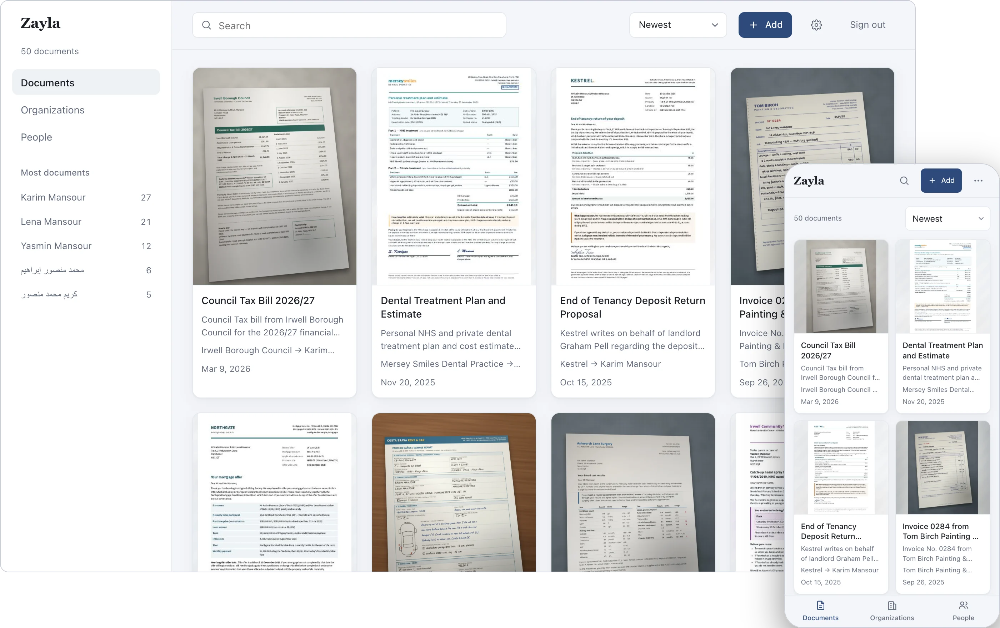
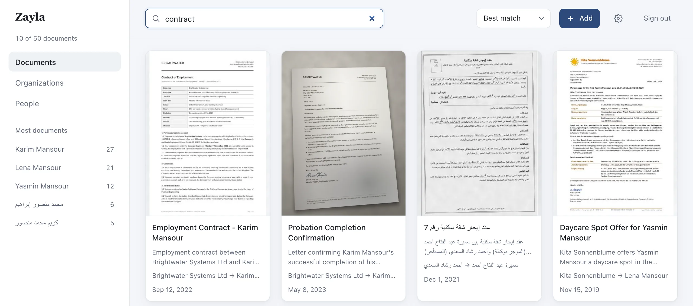
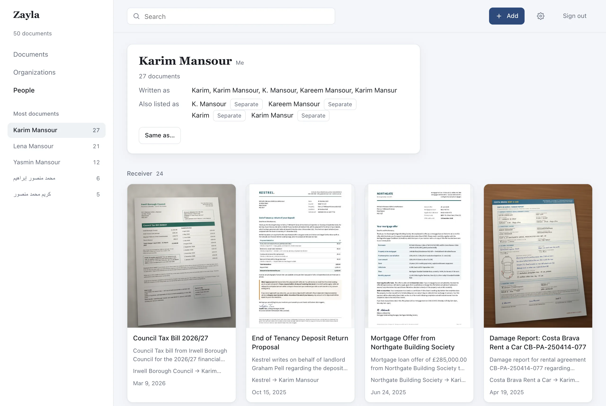

# Zayla

**A self-hosted, open-source document archive, organized by AI.**

Drop in your letters, bills, contracts, IDs and handwritten notes, and find any
of them in seconds, whatever language they're in.

<picture>
  <source media="(prefers-color-scheme: dark)" srcset="docs/screenshots/hero-dark.webp">
  
</picture>

## How it works

**1. Drop in anything.** Letters, bills, contracts, IDs and handwritten notes,
as PDFs or photos.

**2. Zayla reads it for you.** AI extracts a transcription, metadata, and
generates a summary in all the languages you speak. You choose the model, hosted
or on your own hardware.

**3. Find it by what you remember.** A name, a phrase, an amount. Search looks
inside every document, even a photo of a handwritten note.

<picture>
  <source media="(prefers-color-scheme: dark)" srcset="docs/screenshots/search-dark.webp">
  
</picture>

**4. See everything by who it's about.** Open a person or organization to find
every document involving them.

<picture>
  <source media="(prefers-color-scheme: dark)" srcset="docs/screenshots/person-dark.webp">
  
</picture>

**Your library stays yours.** It's plain files you can browse, grep and back up
without Zayla.

## Install with Docker

Zayla is published as `ghcr.io/ielashi/zayla` for amd64 and arm64.

```sh
mkdir zayla && cd zayla
curl -O https://raw.githubusercontent.com/ielashi/zayla/main/compose.yaml
mkdir library
docker compose up -d
docker compose logs zayla
```

Open `http://<your-server>:3000`. The first visit asks for the **Setup code**
printed in the logs; it makes you the owner, so nobody else who reaches the port
can claim Zayla first. Without Compose:

```sh
docker run -d --name zayla -p 3000:3000 -v "$PWD/library:/data" ghcr.io/ielashi/zayla:latest
```

### The library folder

Everything Zayla keeps is plain files in the folder mounted at `/data`: your
original files, what Zayla read out of them, and the people and organizations
they involve. You can browse it, grep it and back it up without Zayla.

The image runs as uid 1000. Create the folder yourself before the first start
(Docker would otherwise create it owned by root, and Zayla couldn't write to
it). If your user isn't uid 1000, either `chown 1000:1000 library`, or keep it
yours and run the container as you, with `user: "<uid>:<gid>"` in
`compose.yaml` (`id -u` and `id -g` print them).

### Passkeys and HTTPS

You can always sign in with a password. Passkeys need two things: HTTPS (a
reverse proxy such as Caddy, Traefik or a Cloudflare tunnel in front of Zayla),
and Zayla knowing the address your browser opens:

```yaml
    environment:
      ZAYLA_URL: https://zayla.example.com
```

`ZAYLA_URL` is an origin, with no path: Zayla is served at the root of its own
domain or subdomain, not under `/zayla`. Once it's set, add a passkey under
Settings.

## License

Zayla is licensed under the [GNU Affero General Public License v3.0](LICENSE).
