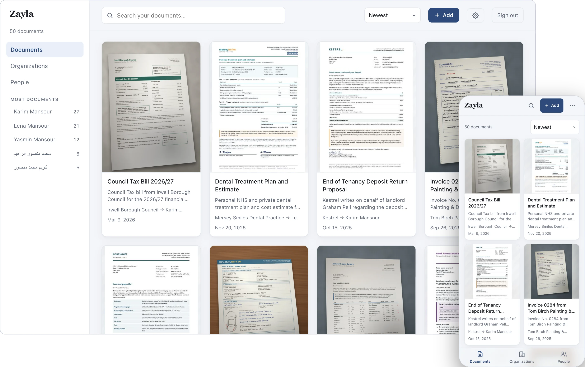
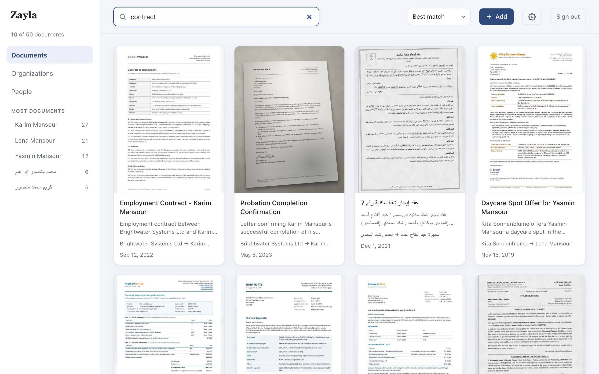
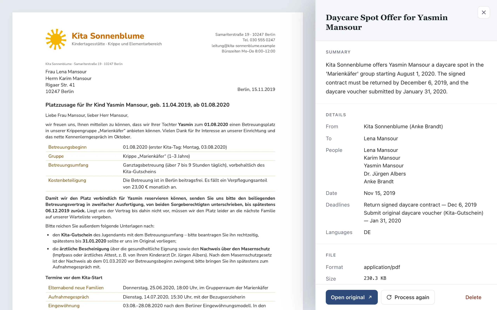
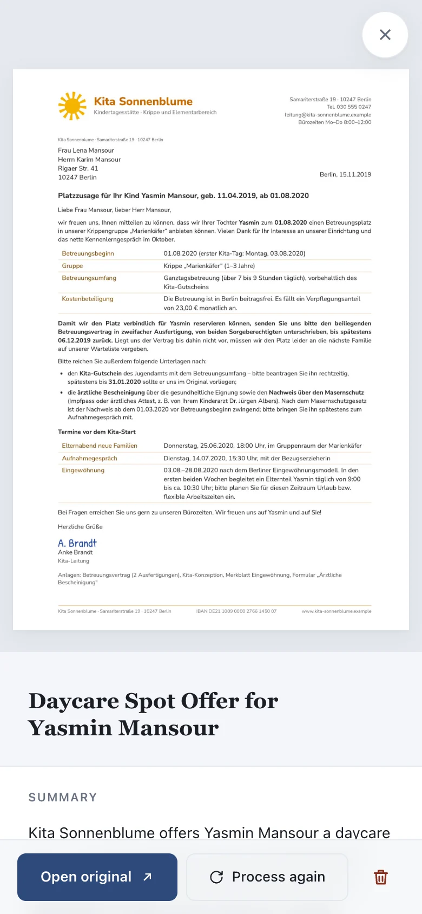
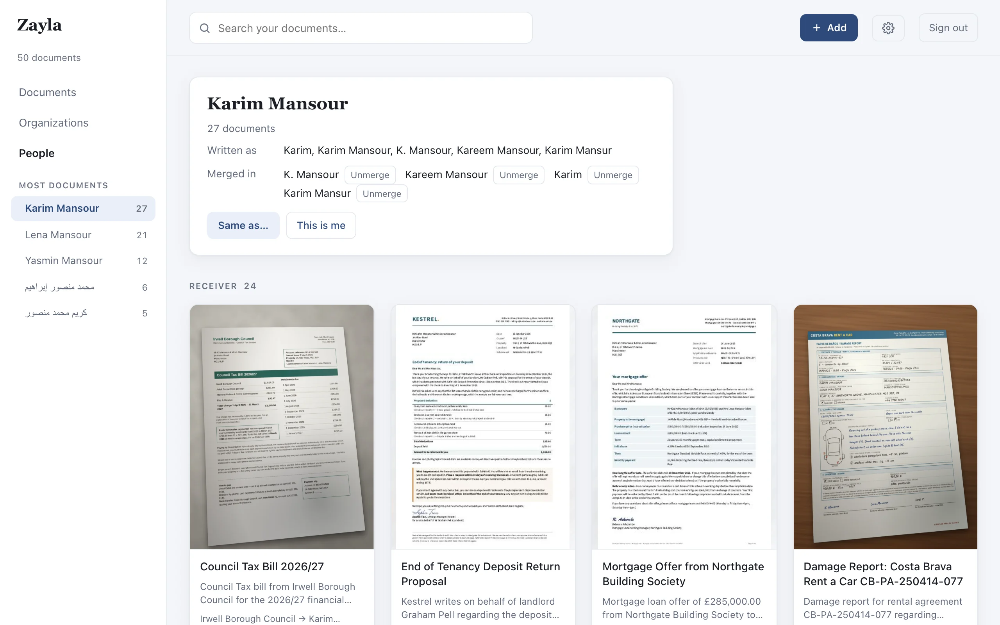

# Zayla

**An open-source document archive, organized by AI.**

Drop in your letters, bills, legal documents, IDs and handwritten notes, and
find any of them in seconds.

<picture>
  <source media="(prefers-color-scheme: dark)" srcset="docs/screenshots/hero-dark.webp">
  
</picture>

## A look inside

**Search across languages.** Zayla writes every Document's title and summary in
your reading languages, so searching for "contract" also finds an Arabic lease
and a German daycare offer.

<picture>
  <source media="(prefers-color-scheme: dark)" srcset="docs/screenshots/search-desktop-dark.webp">
  
</picture>

**Read a Document at a glance.** The Original sits beside what Zayla read out of
it: a summary, who it involves and any deadlines.

<picture>
  <source media="(prefers-color-scheme: dark)" srcset="docs/screenshots/document-desktop-dark.webp">
  
</picture>

It works just as well on your phone.

<picture>
  <source media="(prefers-color-scheme: dark)" srcset="docs/screenshots/document-phone-dark.webp">
  
</picture>

**Browse by Person or Organization.** Tell Zayla that two spellings are one name
and their Documents come together, and you can always take it back.

<picture>
  <source media="(prefers-color-scheme: dark)" srcset="docs/screenshots/person-desktop-dark.webp">
  
</picture>

## Install with Docker

Zayla is published as `ghcr.io/ielashi/zayla` for amd64 and arm64.

```sh
mkdir zayla && cd zayla
curl -O https://raw.githubusercontent.com/ielashi/zayla/main/compose.yaml
mkdir library
docker compose up -d
docker compose logs zayla
```

Open `http://<your-server>:3000`. The first visit asks for the **Setup code**
printed in the logs; it makes you the Library's owner, so whoever reaches the
port before you can't. Without Compose:

```sh
docker run -d --name zayla -p 3000:3000 -v "$PWD/library:/data" ghcr.io/ielashi/zayla:latest
```

### The Library folder

Everything Zayla keeps is plain files in the folder mounted at `/data`: your
Originals, what Zayla read out of them, and the people and organizations they
involve. You can browse it, grep it and back it up without Zayla.

The image runs as uid 1000. Create the folder yourself before the first start
(Docker would otherwise create it owned by root, and Zayla couldn't write to
it). If your user isn't uid 1000, either `chown 1000:1000 library`, or keep it
yours and run the container as you, with `user: "<uid>:<gid>"` in
`compose.yaml` (`id -u` and `id -g` print them).

### Passkeys and HTTPS

You can always sign in with a password. Passkeys need two things: HTTPS (a
reverse proxy such as Caddy, Traefik or a Cloudflare tunnel in front of Zayla),
and Zayla knowing the address your browser opens:

```yaml
    environment:
      ZAYLA_URL: https://docs.example.com
```

`ZAYLA_URL` is an origin, with no path: Zayla is served at the root of its own
domain or subdomain, not under `/zayla`. Once it's set, add a passkey under
Settings.

## License

Zayla is licensed under the [GNU Affero General Public License v3.0](LICENSE).
